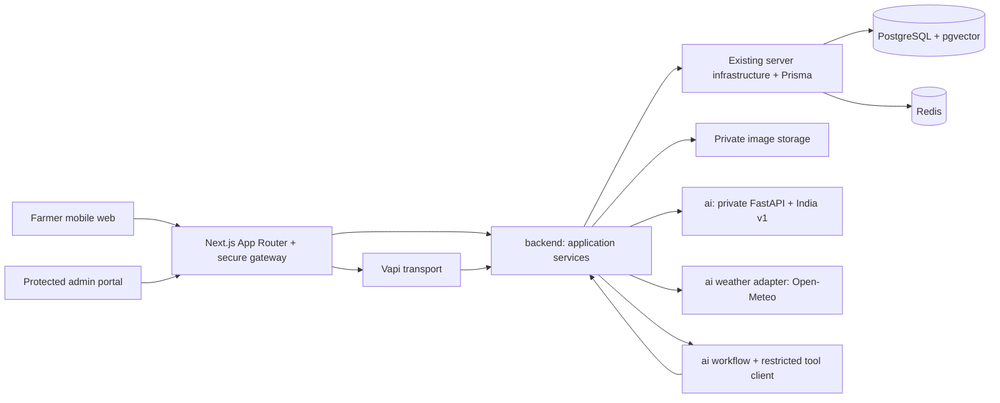

# System architecture

Status: confirmed boundaries; proposed service interfaces. No migration or live integration in this phase.

`/backend` will own farmer/OTP/session policy, ownership/RBAC, farms, diagnosis orchestration, approved recommendation management, notifications, audit and privacy. It reuses `/server` database, API, providers and shared infrastructure rather than creating duplicate implementations. Existing `/modules` generic user/auth services remain until a reviewed migration; no tree moves now.

`/ai` owns ML loading/preprocessing/inference, weather intelligence, approved-knowledge retrieval interfaces, GenAI providers, graph/voice/context/memory abstractions and model monitoring. AI agents have no DB credentials/imports; backend services return authorized DTOs. Existing direct-database AI persistence is a known legacy boundary violation to resolve before enabling farmer agents.

Private FastAPI receives validated image bytes + crop and a service credential; it has no farmer database. Next.js receives a versioned result, applies field-validation policy and stores the diagnosis with owner and provenance. Weather is independent and may fail without hiding the photo assessment. Guidance is selected only from approved, effective records; LLM explains facts without modifying classifier evidence.

Failure design: missing model -> readiness 503; invalid image -> retake without prediction; unsupported crop -> explicit refusal; uncertain result -> candidate language/expert path; weather/voice/LLM down -> core photo/history remain usable once implemented; database/auth down -> fail closed; no mock result silently substitutes for inference.

See AI_MODEL_INTEGRATION.md for the complete `/ai` map, API_CONTRACTS.md for trust boundaries, and SECURITY_AND_PRIVACY.md for required gates.
