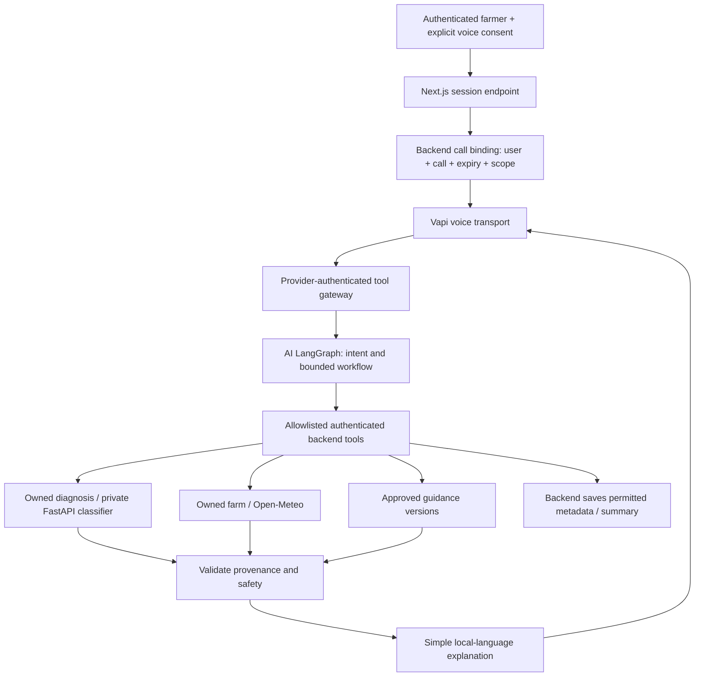

# AI and voice architecture

Status: confirmed responsibility boundaries from the user; proposed runtime design. Preparation only: no assistant created, activated or called, no account settings changed and no credentials read.

## Module allocation; extend existing modules

| Existing/new module | Responsibility and required adaptation |
|---|---|
| `ai/models/agrismart-india` | Pinned checkpoint identity, factual taxonomy/metrics, original strict loader and CLI; no user database |
| `ai/services/inference` | Private FastAPI contract, startup/readiness, bounded CPU work, image validation; actual HTTP service is a later phase |
| `ai/services/weather` | Provider adapter specification, normalized weather values; backend supplies consented farm locality |
| `ai/services/recommendations` | Approved guidance retrieval/validation contract; authoring, permissions and approval stay backend-owned |
| `ai/voice` | Existing browser Vapi provider plus draft assistant/tool specs; replace client identity overrides with opaque server binding before enablement |
| `ai/agents`, `ai/workflows` | Existing LangGraph scaffold extended with explicit state/edges; max steps, cancellation, bounded retries |
| `ai/context`, `ai/conversation`, `ai/memory` | Minimal per-user context, session summary, consent-aware persistence via backend tools; do not use existing direct DB persistence for farmer agents |
| `ai/providers`, `ai/core`, `ai/generation` | Existing model/provider abstractions and LangChain integration; classifier output remains separate from LLM explanations |
| `ai/prompts`, `ai/guardrails` | Versioned prompts, evidence checks, no unapproved treatment; tool policy enforced independently of model output |
| `ai/rag` | Approved public knowledge retrieval only through backend-controlled filters; prohibit current context-free unscoped retrieval |
| `ai/observability` | Redacted LangSmith spans plus deterministic counters; current console logger is only scaffolding |

## Identity and provider authentication

Browser login first; phone number alone and caller-ID are not proof of identity. `POST /api/v1/assistant/session` verifies a real session, consent, feature flags and quotas; backend stores an opaque, short-lived, random context reference bound to owner, assistant, eventual provider call ID, scopes and expiry. Never accept browser/model-supplied user ID or role as authority. Provider call creation and binding must be server-verifiable; SDK metadata alone cannot securely establish the call binding. Validate this exact lifecycle against the selected Vapi account before implementation.

Vapi currently documents Custom Credentials referenced by `credentialId`, including bearer, OAuth and HMAC options: https://docs.vapi.ai/server-url/server-authentication . Proposed use: a dedicated credential per environment on tool/webhook server configuration. Backend compares authenticated credentials, validates request schema and known assistant/call binding, checks expiry and replay/duplicate events. HMAC timestamp/body rules must follow the actually configured documented mechanism; do not invent a universal signature header. A static bearer does not itself provide replay prevention; use atomic event/tool-call ID deduplication plus session expiry. Rotate credentials and fail closed on missing configuration.

Every tool call is re-authorized in `/backend`, even after provider authentication. No tool accepts `farmerId`, SQL, arbitrary URL, storage path or arbitrary tool name supplied by the model. Farm/diagnosis references are only hints and are checked against the bound account. Non-owned references return a generic not-found result. Farmer assistant schemas exclude admin tools altogether. Separate admin identity, credentials and tool registries if admin AI is ever introduced.

## Graph and tool execution

Nodes: authenticate binding -> load permitted context -> classify intent -> choose one allowlisted tool -> validate typed tool result -> retrieve approved guidance -> generate brief localized response -> check safety -> speak -> save permitted history. Diagnosis without a photo asks for one; voice text is not a substitute image classifier. Weather errors produce an unavailable response; uncertain diagnoses offer retake/expert review. Unsupported requests get a clarifying question or human handoff.

Initial tools: `get_my_profile`, `get_my_diagnosis`, `get_my_diagnosis_history`, `get_my_farm_weather`, `get_approved_guidance`. Later `save_my_feedback` and `request_expert_callback` require explicit user action/confirmation and backend validation. No arbitrary mutations in the initial registry. Tool outputs contain minimal facts, source/version/time, warnings and permitted references, never full database rows.

Proposed budgets: max 6 tool calls and 10 graph steps per turn, 5-second ordinary tool timeout with a separate bounded diagnosis polling flow, at most one retry for retry-safe reads; set actual latency budgets after voice testing. Persistent graph thread keys must include server-bound owner/session; never accept a thread ID to read another user's state. Use the existing `@langchain/core` and `@langchain/langgraph` packages, not a parallel Python application agent stack. Provider adapters and graph APIs require installed-version validation. Official graph reference: https://docs.langchain.com/oss/javascript/langgraph/overview .

## Guidance, memory and observability

LLM may summarize approved non-chemical advice. Chemical names/doses/application steps must be returned as a versioned, locale-reviewed approved guidance fragment; render/speak that fragment without creative paraphrasing or numeric changes. No approved fragment means no chemical instruction. Prompts and retrieved documents are untrusted data, not authority to expand tool access. Classifier confidence is an uncalibrated score; no severity or laboratory confirmation is inferred.

Context contains preferred locale, optional provided name, minimal current diagnosis and approved facts. Avoid phone, exact GPS, raw images, secrets and unrestricted transcripts in prompts. Persist call IDs, lifecycle, consent version, tool outcomes and optional approved summary through backend services. Recordings/transcripts default off pending policy/provider confirmation. Deletion must cover backend, provider, traces and backups; retention durations remain unresolved.

LangSmith instrumentation is proposed, disabled by default until redaction and data-processing decisions pass review. Trace node name, latency, tool status and pseudonymous request reference; strip payloads at the tracing boundary, not just console output. Future tests must exercise provider forgery, expired/replayed calls, cross-farmer references, injection, consent withdrawal, tool loops, stale advice and treatment hallucination.
